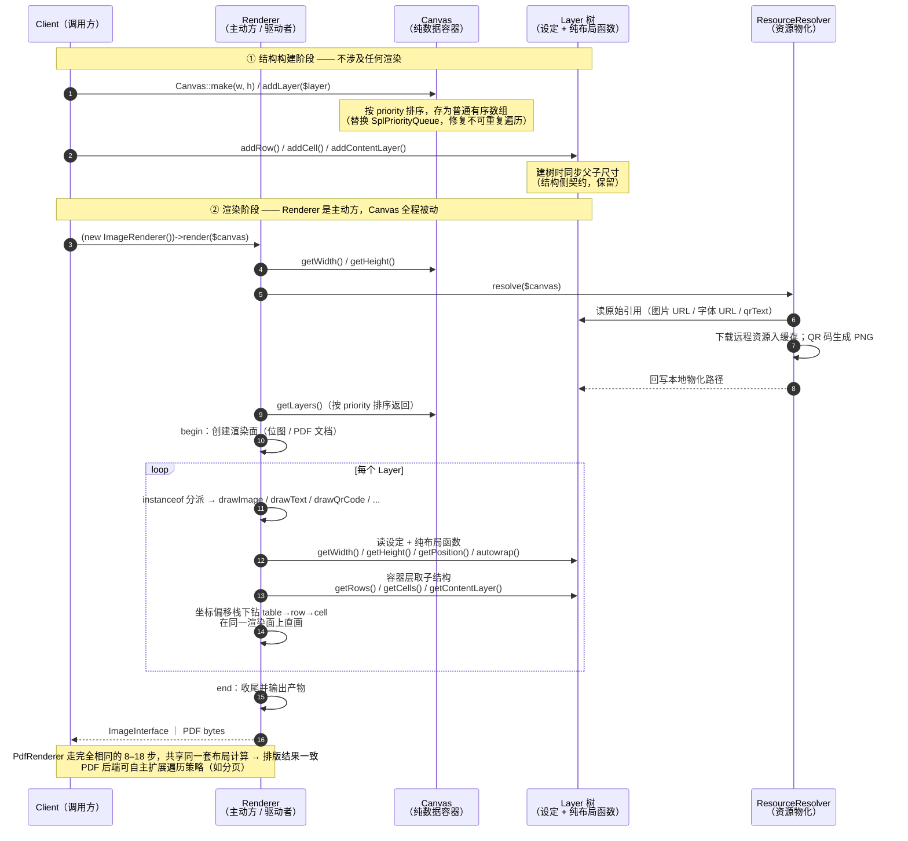
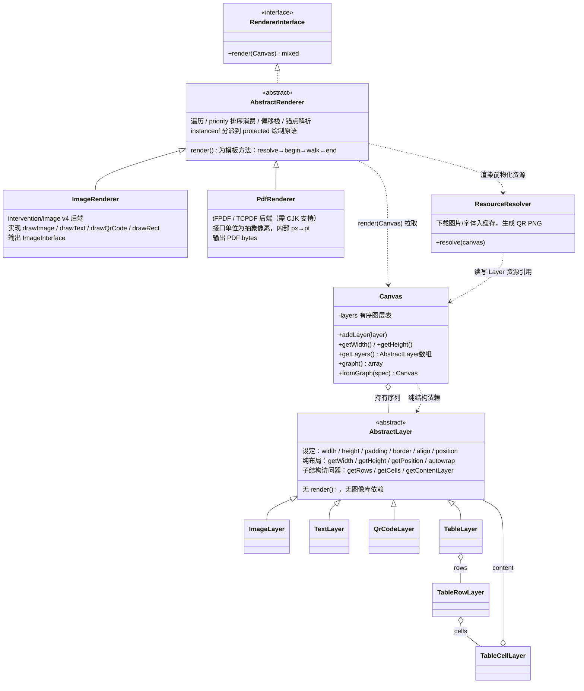
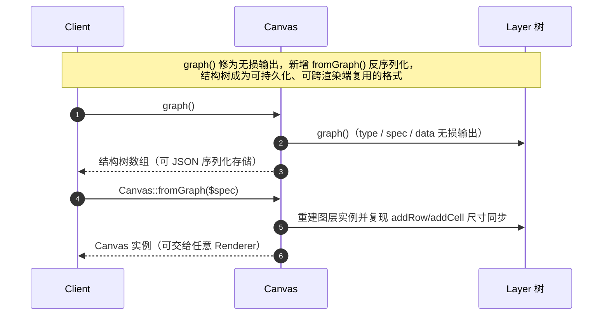
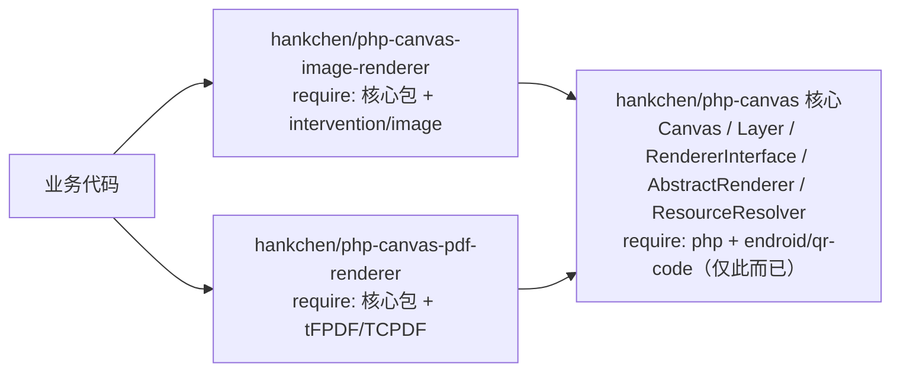

# Layer / Renderer 分离 — 对象交互设计（待确认）

> 目标架构：**`Renderer::render(Canvas)`，Renderer 是主动方**：由 Renderer 向 Canvas 拉取
> 尺寸与有序图层，按图层类型分派，读取 Layer 的"设定 + 纯布局函数"完成渲染。
> Canvas 是纯数据容器，只有访问器，不依赖任何 Renderer。
> 本文档为设计确认稿，确认后按文中迁移顺序实施。

## 一、渲染主流程（对象交互时序）

## 二、静态类关系

要点：
- **公开接口只有一个方法** `render(Canvas): mixed`；遍历/分派/偏移栈等通用逻辑收在
  `AbstractRenderer` 模板方法里，两个后端只实现 `draw*` 绘制原语，互不重复；
- 特殊后端（比如要自定义遍历的）可以直接实现 `RendererInterface`，不走基类；
- Layer 与 Canvas 均不感知 Renderer，依赖方向永远是 Renderer → Canvas → Layer。

## 三、结构持久化 graph() / fromGraph()

## 关键决策点（请逐条确认）

| # | 决策 | 取舍 |
|---|------|------|
| 1 | **Renderer 驱动**：`RendererInterface::render(Canvas): mixed` 唯一入口 | Canvas 退为纯数据容器（只有访问器），不依赖任何 Renderer |
| 2 | 通用遍历收进 `AbstractRenderer` 模板方法（resolve→begin→walk→end） | 两个后端只实现 `draw*` 原语；特殊后端可直接实现接口绕过基类 |
| 3 | 类型分派：Renderer 内 `instanceof` → protected `draw*` 方法 | 不引入 visitor 双分派；新增后端=一个类 |
| 4 | 布局计算留在 Layer（纯函数），不进 Renderer | 断行/对齐/autoHeight 两端共享，排版不分叉 |
| 5 | 资源物化（下载、QR 生成）由 Renderer 在绘制前调 resolve 完成 | Renderer 只见本地路径；不再混入 setter |
| 6 | 容器下钻：Renderer 直画根表面 + 坐标偏移栈 | 取代"子层渲染中间位图再 insert"，结果等价 |
| 7 | 兼容：`Layer::render()` 保留为 deprecated 快捷方式（内部 new ImageRenderer 跑一遍） | 现有用户代码不断，最终移除 |
| 8 | `graph()` 补无损 + 新增 `fromGraph()` | 修三处有损：TableLayer 只存首行、字体只存 basename、QR 未生成时 value 为空 |

## 四、拆包评估（Renderer 独立成包）

### 结论

建议拆，但**分两阶段**：先在当前仓库内完成目录/命名空间分层（成本≈0），
等 `PdfRenderer` 落地、`RendererInterface` 经历一轮真实使用稳定后，再物理拆仓。
现在就拆 3 个仓库会让尚未定型的契约马上付出跨仓协调成本。

### 依赖图（拆包后）

### 为什么值得拆（判据）

1. **依赖隔离是硬收益**：`intervention/image` 需要 ext-gd/ext-imagick，是全项目唯一的
   PHP 扩展硬依赖。PDF-only 的用户（典型部署在无 GD 的环境）现在被迫背上图像扩展；
   反之图像用户也不该装 tFPDF。拆包后核心包 require 只剩 `php + endroid/qr-code`。
2. **生态先例成熟**：flysystem（核心 + `flysystem-aws-s3-v3` 等 adapter 包）就是这个模式，
   "契约在核心、实现按后端拆包"是 PHP 生态惯例，用户理解成本低。
3. **第三方可扩展**：接口包公开后，社区可自行实现 svg-renderer 等，无需改核心。

### 三个必须先定的放置细节

| 组件 | 放哪 | 原因 |
|------|------|------|
| `RendererInterface` + `AbstractRenderer`（模板方法） | **核心包** | 遍历/分派/偏移栈只依赖结构类型；放下游会导致后端包互相依赖或复制遍历逻辑 |
| `ResourceResolver`（含 endroid QR 物化） | **核心包** | QrCodeLayer 是结构层类型，任何后端都要物化它，放下游会在每个后端重复 |
| deprecated `Layer::render()` 兼容垫 | **1.x 保留原样，2.0 拆包时移除** | 兼容垫需要 ImageRenderer，会反向污染"核心零感知渲染"；见下 |

**兼容性冲突说明**：`Layer::render()` 委托默认 Image 后端才能产出 ImageInterface，
这要求核心知道具体渲染器，与拆包后的"核心不依赖任何渲染库"直接矛盾。
处置：1.x 线（拆包前）保留 deprecated 垫；2.0 拆包时随分离一起移除（本来就是破坏面），
迁移路径为 `$layer->render()` → `(new ImageRenderer())->renderLayer($layer)`，
`renderLayer()` 作为 BC 便捷方法放在 image-renderer 包。

### 代价与缓解

- **3 份仓库维护**（composer.json、CI、CHANGELOG）：契约期长、`RendererInterface` 标注 `@api` 严格 semver；
- **跨包破坏性变更需联动发版**：后端包约束核心 `"^2.0"`；文档写明版本配套关系；
- **核心包测试不再依赖图像扩展**：布局纯函数 / graph 序列化 / fromGraph 往返都不需要真渲染，
  现有 driver 差异 hack（systemTtf、usesImagickDriver）全部留在 image-renderer 包——核心 CI 反而简化。

### 更新后的落地路线

1. **阶段一（同仓）**：`src/Renderer/`（契约+AbstractRenderer+Resolver）、`src/Renderer/Image/` 分层，完成前述迁移 1–3 步；
2. **阶段二（同仓）**：`src/Renderer/Pdf/` 实现 PdfRenderer，用真实场景打磨接口；
3. **阶段三（拆仓）**：接口稳定后物理拆为 3 包，核心包 composer require 收缩为 `php + endroid/qr-code`，
   `suggest` 指向两个渲染器包，后端包约束核心 `^2.0`。

## 迁移顺序（阶段一，同仓内）

1. 图层加子结构访问器（`getRows()`/`getCells()`/`getContentLayer()`），QrCodeLayer 改存 text，Canvas 暴露 `getWidth()/getHeight()/getLayers()`——纯增量；
2. 抽 `RendererInterface` + `AbstractRenderer` + `ImageRenderer`，搬移 7 个 `render()` 的像素逻辑，像素采样测试保绿；
3. Layer 删 `render()`，资源下载移到 resolve 阶段（唯一破坏面，deprecated 快捷方式在此垫）；
4. 新增 `PdfRenderer`（tFPDF/TCPDF，硬门槛 CJK/UTF-8）；
5. 接口稳定后按"拆包评估"一节物理拆仓。
